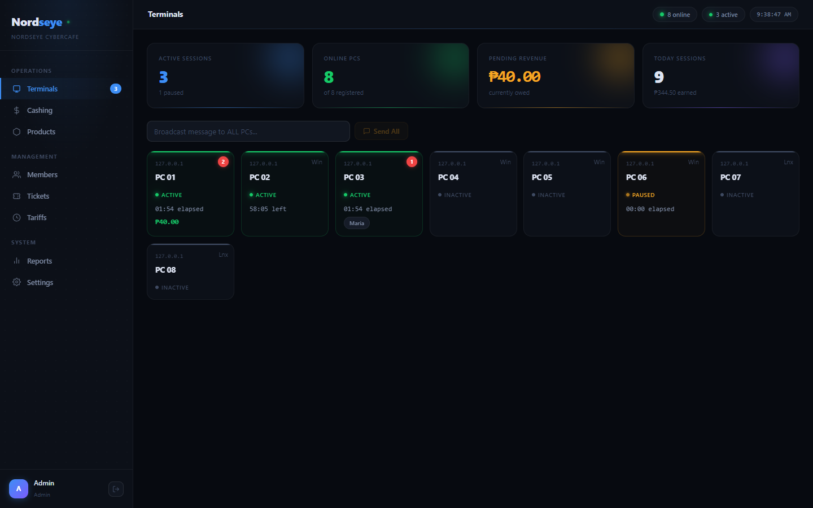
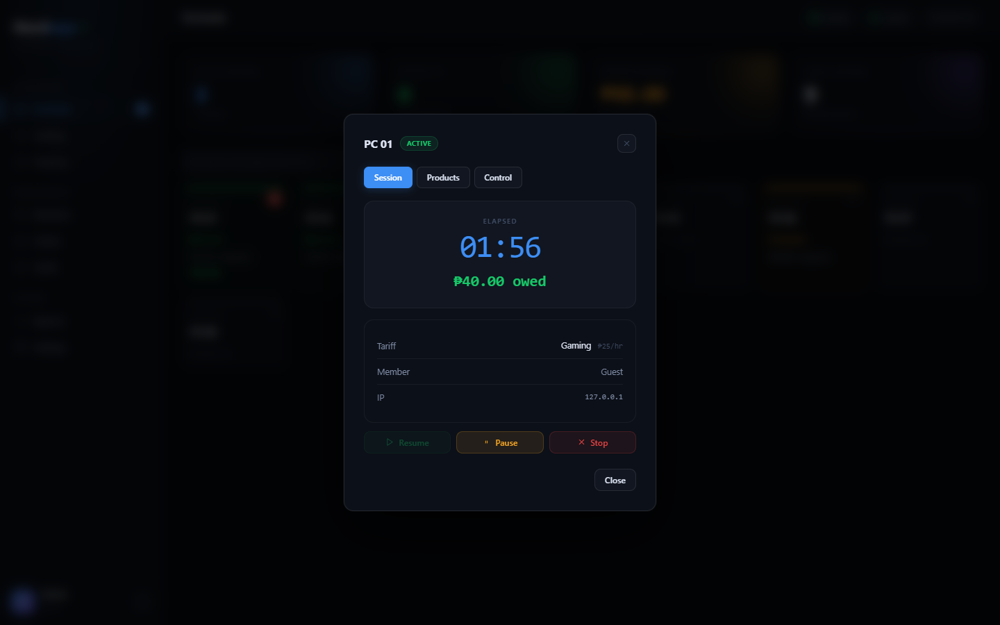
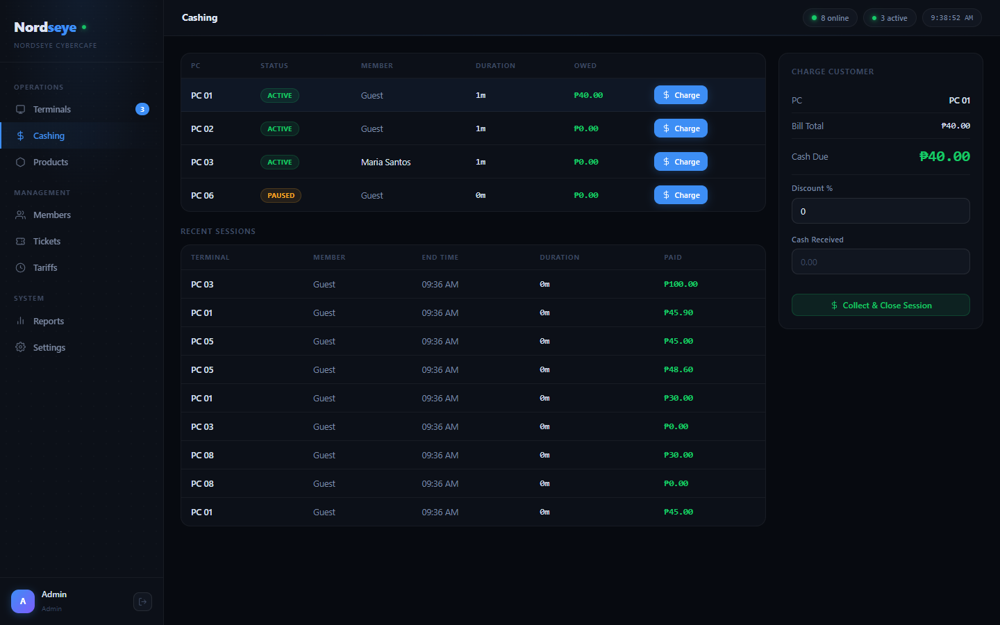
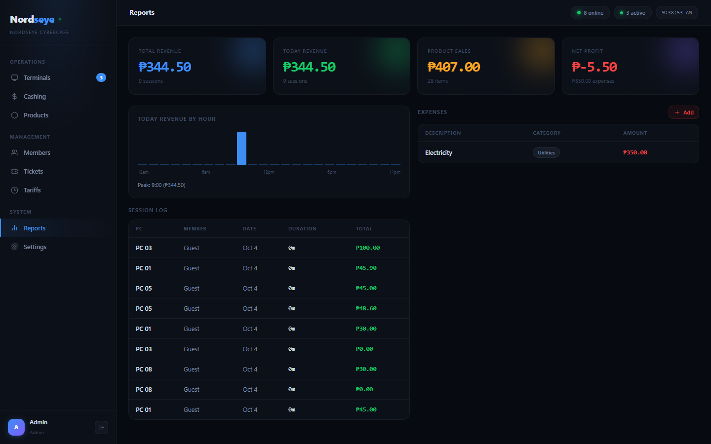
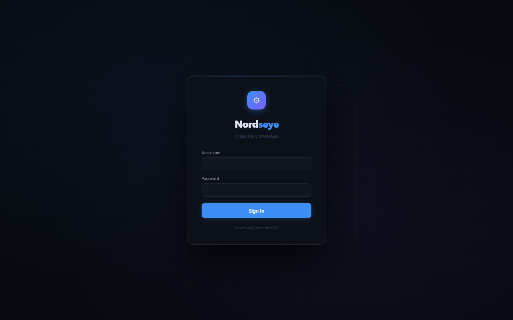

# Nordseye Cyber Cafe Manager

Run your internet cafe from one screen. Nordseye locks every customer PC
until a session is started, times and bills it, sells your snacks and
prints, and tells you at the end of the day what you earned.

**[⬇ Download the latest release](../../releases/latest)**

---

## What it does

**For the counter**
- **Every PC at a glance:** who is on, for how long, what they owe, and what they bought.
- **Start a session your way:** open-ended, timed (10 min to hours), as a
  member, or with a printed **ticket code** the customer types in themselves.
- **Billing done for you:** hourly tariffs with free minutes, product sales,
  discounts, tax, and member credit used up automatically.
- **Collect & close** in one step, with change worked out and everything recorded.
- **Message one PC, or all of them.**

**For the customer PC**
- A **lock screen** until the counter starts a session; it shows the time left
  and the amount owed while they play.
- Locks again by itself when time runs out or the session ends, and shows a receipt.
- Pausing locks the PC; the counter resumes it.

**For the owner**
- **Reports:** today's and total revenue, revenue by hour, product sales,
  expenses and net profit.
- **Staff accounts:** admins and cashiers, with cashiers kept away from
  prices, tariffs and settings.
- **Members** with prepaid credit, **products** with stock, **tariffs** by day of the week.

**Built to keep running**
- Works on your **local network only**: no internet needed, no monthly fee, your data stays in the cafe.
- Starts by itself when the PCs are switched on, and recovers by itself if
  something stops or freezes. Running sessions carry on after a restart or power cut.
- Windows and Linux, mixed freely: a Windows server with Linux customer PCs is fine.

| | |
|---|---|
|  |  |
|  |  |

---

## What you need

- One **server PC** at the counter, and the **customer PCs**, all on the same
  network (same router or switch).
- **Windows 10/11**, or **Linux**: Ubuntu 22.04+, Debian 12+, Fedora.
- **Windows only:** Python 3.10 or newer from
  [python.org](https://www.python.org/downloads/windows/). In the installer,
  tick **"Install for all users"**, **"Add python.exe to PATH"** and
  **"tcl/tk and IDLE"**. On Linux, the packages install everything they need.

---

## Install

Download the files for your system from the
**[latest release](../../releases/latest)**.

### 1. The server (counter PC)

| System | File | How |
|---|---|---|
| Windows | `nordseye-server-<version>-windows.zip` | Unzip, double-click **`install-server.bat`** |
| Ubuntu / Debian | `nordseye-server_<version>_all.deb` | `sudo apt install ./nordseye-server_<version>_all.deb` |
| Fedora | `nordseye-server-<version>-1.noarch.rpm` | `sudo dnf install ./nordseye-server-<version>-1.noarch.rpm` |

Then open the dashboard: **http://localhost:8766/**. From another device,
use `http://<server IP>:8766/`.

### 2. Each customer PC

| System | File | How |
|---|---|---|
| Windows | `nordseye-agent-<version>-windows.zip` | Unzip, double-click **`install-agent.bat`**, enter the server's IP and a name like `PC 01` |
| Ubuntu / Debian | `nordseye-agent_<version>_all.deb` | `sudo apt install ./nordseye-agent_<version>_all.deb` then `sudo nordseye-agent-setup --server <server IP> --name "PC 01"` |
| Fedora | `nordseye-agent-<version>-1.noarch.rpm` | `sudo dnf install ./nordseye-agent-<version>-1.noarch.rpm` then `sudo nordseye-agent-setup --server <server IP> --name "PC 01"` |

Sign out and back in (or reboot). The PC shows the lock screen and appears on
the dashboard.

---

## First steps

1. **Sign in** with **admin / 1234**.
2. **Make it yours:** Settings → Employees → add your own admin account, sign
   in with it, and **delete `admin`**. Add cashier accounts for your staff.
3. Set your cafe name, currency and tax under **Settings**, and your prices
   under **Tariffs** and **Products**.
4. Click a PC on **Terminals** to start its first session.

## Good to know

- **Give the server PC a fixed IP address** (in your router: "DHCP
  reservation"). If its address changes, the customer PCs can't find it.
- **Windows server:** set the network to **Private** (Settings → Network &
  internet → your connection). On a "Public" network, customer PCs can't connect.
  On Fedora, allow the server through the firewall with
  `sudo firewall-cmd --permanent --add-service=nordseye && sudo firewall-cmd --reload`.
- **Customer PCs:** use a standard (non-admin) Windows/Linux account that
  signs in automatically.
- **Windows server:** `stop-server.bat` / `start-server.bat` (in the folder
  you unzipped) stop and start it; it also starts by itself at every boot. Your data is kept in
  `C:\ProgramData\Nordseye\Server` (Linux: `/var/lib/nordseye`). Back that
  folder up.

---

Nordseye is proprietary software. © 2026 Nordseye. All rights reserved.
